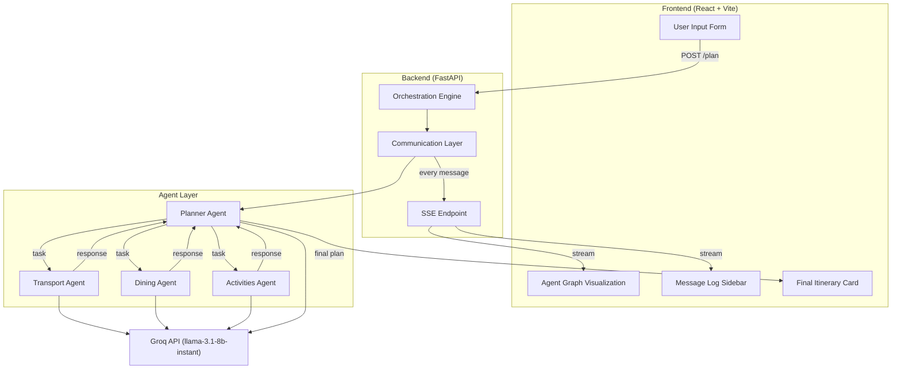
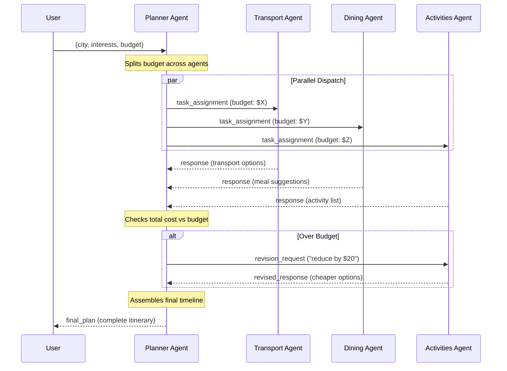

# 🗺️ Multi-Agent Travel Day Planner — Full Architecture Plan

> **Purpose:** College POC demonstrating multi-agent collaboration  
> **Stack:** React (Vite) + FastAPI (Python) + Groq API  
> **Agents:** 4 (Transport, Dining, Activities, Planner/Orchestrator)  
> **Data:** LLM-generated (no external APIs)  
> **Real-time:** Server-Sent Events (SSE)  
> **Model:** `llama-3.1-8b-instant` (fast, fits free-tier rate limits with 4 agents)

---

## 1. Project Overview

The user enters a **city**, **interests**, and **budget**. The system kicks off 4 AI agents that collaborate to build a full day plan. The UI shows a **live animated graph** — agents as nodes, messages as animated edges — with a **chat log sidebar** showing every inter-agent message in real-time.

```
User Input → Planner Agent → [Transport, Dining, Activities] (parallel)
                  ↑                          |
                  └── aggregation ←──────────┘
                  ↓
           Planner assembles final itinerary
                  ↓
           If budget exceeded → re-negotiate with agents
                  ↓
           Final Day Plan rendered in UI
```

---

## 2. Agent Design

### Agent Roles

| Agent | Role | Inputs | Outputs |
|---|---|---|---|
| **Planner** (Orchestrator) | Dispatches tasks, collects results, resolves conflicts, assembles final itinerary | User query, agent responses | Task assignments, budget feedback, final itinerary |
| **Transport** | Suggests how to get around the city | City, budget slice | Transport options with estimated costs & times |
| **Dining** | Suggests meals (breakfast, lunch, dinner) | City, interests, budget slice | Restaurant/food suggestions with costs & times |
| **Activities** | Suggests sightseeing, experiences | City, interests, budget slice | Activity list with costs, durations, locations |

### Agent Communication Protocol

Every message between agents follows this schema:

```json
{
  "from_agent": "planner",
  "to_agent": "dining",
  "message_type": "task_assignment | response | revision_request | revised_response | final_plan",
  "content": "...",
  "metadata": {
    "budget_allocated": 50,
    "timestamp": "2026-10-22T10:00:00Z",
    "step": 1
  }
}
```

### Orchestration Flow (Step by Step)

```
Step 1: Planner receives user input
Step 2: Planner splits budget & sends task_assignment to Transport, Dining, Activities (PARALLEL)
Step 3: Transport, Dining, Activities each respond with suggestions
Step 4: Planner checks total cost vs budget
Step 5a: If within budget → Planner assembles final itinerary
Step 5b: If over budget → Planner sends revision_request to the most expensive agent(s)
Step 6: Agent(s) respond with cheaper alternatives
Step 7: Planner assembles final itinerary
```

> [!IMPORTANT]
> The **re-negotiation loop** (Steps 5b–6) is the key collaboration demo — it shows agents adapting based on feedback from another agent. This is what makes it more than just "3 independent API calls."

---

## 3. System Architecture



### Three Layers

| Layer | Responsibility | Implementation |
|---|---|---|
| **Communication Layer** | Routes messages between agents, logs all messages, streams events to frontend | Python class `MessageBus` with an in-memory queue + SSE broadcast |
| **Orchestration Layer** | Defines the workflow (who runs when, parallel vs sequential, re-negotiation logic) | Python class `Orchestrator` that drives the Planner agent's logic |
| **Agent Layer** | Individual agents that call Groq and return structured responses | Python class `Agent` with role-specific system prompts |

---

## 4. File Structure

```
travel-planner/
├── backend/
│   ├── main.py              # FastAPI app, SSE endpoint, /plan endpoint
│   ├── agents.py            # Agent class + 4 agent definitions (system prompts)
│   ├── orchestrator.py      # Orchestration flow logic (the step-by-step pipeline)
│   ├── message_bus.py       # Communication layer (message routing + SSE broadcasting)
│   ├── models.py            # Pydantic models (AgentMessage, UserInput, Itinerary)
│   └── requirements.txt     # fastapi, uvicorn, groq, pydantic
│
├── frontend/
│   ├── index.html
│   ├── package.json
│   ├── vite.config.js
│   └── src/
│       ├── App.jsx           # Main layout: input form + graph + sidebar + itinerary
│       ├── main.jsx          # React entry point
│       ├── components/
│       │   ├── InputForm.jsx     # City, interests, budget form
│       │   ├── AgentGraph.jsx    # Live animated node-edge graph (react-flow)
│       │   ├── MessageLog.jsx    # Scrolling chat log of all agent messages
│       │   └── Itinerary.jsx     # Final day plan card
│       ├── hooks/
│       │   └── useSSE.js         # Custom hook to consume SSE stream
│       └── styles/
│           └── app.css           # Minimal styling
│
├── .env                      # GROQ_API_KEY
└── README.md                 # Setup instructions + architecture overview
```

> **Total: 16 files.** That's it.

---

## 5. Tech Stack & Dependencies

### Backend (Python)
| Package | Purpose |
|---|---|
| `fastapi` | API framework |
| `uvicorn` | ASGI server |
| `groq` | Groq Python SDK |
| `pydantic` | Data validation / message schemas |
| `python-dotenv` | Load `.env` |

### Frontend (React)
| Package | Purpose |
|---|---|
| `react` + `react-dom` | UI framework |
| `@xyflow/react` | Node-edge graph visualization (formerly React Flow) |
| `vite` | Build tool |

> [!TIP]
> **Why SSE over WebSockets?** SSE is unidirectional (server → client), which is exactly what we need — the client sends one request and then passively receives a stream of agent events. It's simpler to implement (no socket management), works over standard HTTP, and produces smooth animations. Much less code than WebSockets.

---

## 6. Backend Detail

### `models.py` — Data Schemas

```python
class UserInput(BaseModel):
    city: str
    interests: list[str]
    budget: float  # total budget in USD

class AgentMessage(BaseModel):
    from_agent: str
    to_agent: str
    message_type: str  # task_assignment, response, revision_request, revised_response, final_plan
    content: str
    metadata: dict

class Itinerary(BaseModel):
    city: str
    transport: dict
    dining: dict
    activities: dict
    total_cost: float
    timeline: list[dict]  # ordered list of time-slotted items
```

### `message_bus.py` — Communication Layer

```python
class MessageBus:
    def __init__(self):
        self.log: list[AgentMessage] = []
        self.subscribers: list[asyncio.Queue] = []  # SSE listeners

    async def send(self, message: AgentMessage):
        self.log.append(message)
        for queue in self.subscribers:
            await queue.put(message)  # broadcast to all SSE clients

    def subscribe(self) -> asyncio.Queue:
        queue = asyncio.Queue()
        self.subscribers.append(queue)
        return queue
```

### `agents.py` — Agent Definitions

```python
class Agent:
    def __init__(self, name: str, system_prompt: str, groq_client, message_bus):
        self.name = name
        self.system_prompt = system_prompt
        self.client = groq_client
        self.bus = message_bus

    async def run(self, task: str, metadata: dict) -> str:
        # 1. Call Groq with system prompt + task
        # 2. Parse response
        # 3. Send result as AgentMessage via message_bus
        # 4. Return result
```

Each agent gets a tailored system prompt. Example for Dining:

```
You are a Dining Agent. Given a city, cuisine interests, and a budget,
suggest breakfast, lunch, and dinner options. For each meal, provide:
- Restaurant/food name
- Estimated cost
- Suggested time
- Brief description
Return your response as valid JSON.
```

### `orchestrator.py` — Orchestration Logic

```python
class Orchestrator:
    def __init__(self, planner, transport, dining, activities, message_bus):
        ...

    async def run(self, user_input: UserInput):
        # Step 1: Planner splits budget
        budget_split = await self.planner.plan_budget(user_input)

        # Step 2: Dispatch to specialist agents IN PARALLEL
        results = await asyncio.gather(
            self.transport.run(task, budget_split["transport"]),
            self.dining.run(task, budget_split["dining"]),
            self.activities.run(task, budget_split["activities"]),
        )

        # Step 3: Planner checks total cost
        total = sum of costs from results
        if total > user_input.budget:
            # Step 4: Re-negotiate with most expensive agent
            ...

        # Step 5: Planner assembles final itinerary
        final = await self.planner.assemble(results)
        return final
```

### `main.py` — FastAPI App

```python
@app.post("/api/plan")
async def create_plan(user_input: UserInput):
    # Start orchestration in background task
    # Return session_id for SSE subscription

@app.get("/api/stream/{session_id}")
async def stream_events(session_id: str):
    # SSE endpoint: yields AgentMessage events as they flow through MessageBus
```

---

## 7. Frontend Detail

### Layout

```
┌─────────────────────────────────────────────────────┐
│  🗺️ Multi-Agent Travel Day Planner                  │
├─────────────┬───────────────────────┬───────────────┤
│             │                       │               │
│  Input Form │   Agent Graph         │  Message Log  │
│  (left)     │   (center)            │  (right)      │
│             │                       │               │
│  City: ____ │   [Planner]──→[Trans] │  🤖 Planner→  │
│  Interests: │       │  ╲            │    Transport:  │
│  Budget: __ │       ↓    ╲          │    "Find..."   │
│             │   [Dining] [Activ]    │               │
│  [Plan!]    │                       │  🍽️ Dining→    │
│             │                       │    Planner:    │
│             │                       │    "Here are.."│
├─────────────┴───────────────────────┴───────────────┤
│  📋 Final Itinerary (appears when done)             │
│  9:00 - Breakfast at ... | 10:00 - Visit ... | ...  │
└─────────────────────────────────────────────────────┘
```

### Agent Graph (`AgentGraph.jsx`)

Uses **@xyflow/react** (React Flow):
- **4 nodes** — Planner (center-top), Transport (right), Dining (bottom-left), Activities (bottom-right)
- **Animated edges** — when a message flows from Agent A → Agent B, the edge glows/animates
- **Node status** — idle (grey), thinking (pulsing yellow), done (green), revising (orange)
- **Edge labels** — briefly show the message type (e.g., "task_assignment", "revision_request")

### SSE Hook (`useSSE.js`)

```javascript
function useSSE(sessionId) {
  const [messages, setMessages] = useState([]);
  const [status, setStatus] = useState("idle");

  useEffect(() => {
    if (!sessionId) return;
    const source = new EventSource(`/api/stream/${sessionId}`);
    source.onmessage = (e) => {
      const msg = JSON.parse(e.data);
      setMessages(prev => [...prev, msg]);
      if (msg.message_type === "final_plan") setStatus("done");
    };
    return () => source.close();
  }, [sessionId]);

  return { messages, status };
}
```

---

## 8. Orchestration Sequence Diagram



---

## 9. Key Design Decisions

| Decision | Choice | Rationale |
|---|---|---|
| SSE over WebSockets | SSE | Unidirectional is sufficient; less code, no socket library needed |
| `llama-3.1-8b-instant` | Fast model | 4 agents × multiple calls = needs to stay within free-tier rate limits (30 req/min) |
| LLM-generated data | No real APIs | Zero external dependencies, no API keys beyond Groq, still produces realistic output |
| React Flow for graph | `@xyflow/react` | Industry-standard graph library, built-in edge animations, minimal setup |
| In-memory MessageBus | No Redis/DB | It's a POC — no persistence needed, keeps deployment simple |
| JSON responses from agents | Structured output | Planner can parse and aggregate reliably |

---

## 10. How to Run (for README)

```bash
# Backend
cd backend
pip install -r requirements.txt
echo "GROQ_API_KEY=your_key_here" > .env
uvicorn main:app --reload

# Frontend
cd frontend
npm install
npm run dev
```

---

## 11. What Makes This a Good College POC

1. **Clear multi-agent architecture** — Communication Layer, Orchestration Layer, Agent Layer are cleanly separated
2. **Demonstrates key patterns** — parallel dispatch, aggregation, re-negotiation/feedback loops
3. **Visual proof** — the animated graph + message log makes the collaboration tangible and demo-friendly
4. **Minimal but real** — 16 files, no bloat, but the system actually works end-to-end
5. **Uses current tech** — Groq (fast LLM inference), React Flow (modern visualization), FastAPI (modern Python API)
6. **Extensible** — easy to add more agents or swap in real APIs for a future iteration

> [!IMPORTANT]
> **Rate Limit Strategy:** Groq free tier allows ~30 requests/minute. With 4 agents + planner logic, a single plan uses ~6-8 API calls (3 parallel + planner calls + possible renegotiation). We add a small delay between non-parallel calls to stay safe. The `llama-3.1-8b-instant` model is chosen specifically because it's the fastest and least rate-limited on Groq.

