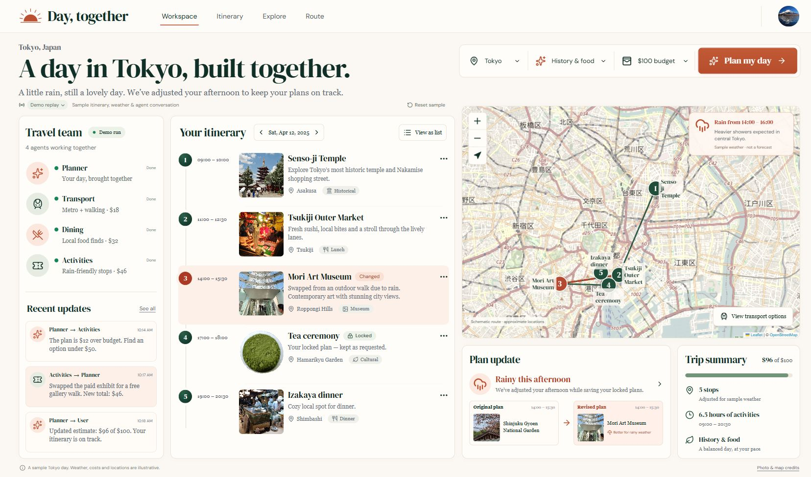
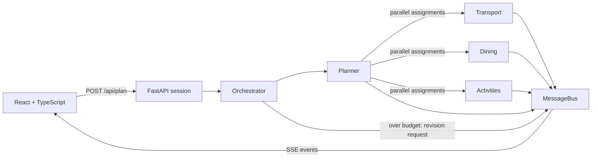

# Day, together — Multi-Agent Travel Day Planner

This separate checkout rebuilds the supplied dashboard in React + TypeScript. See [UI-REBUILD.md](../UI-REBUILD.md) for its demo/live modes, interactive map, verification, and current limitations.



Screenshot shows the labelled Tokyo demo. Live AI uses the actual backend event stream.

## Setup

Use Python 3.10+ and Node.js 20.19+ or 22.12+ (verified here with Python 3.12 and Node.js 24).

From the repository root on Windows PowerShell:

```powershell
python -m venv .venv
.\.venv\Scripts\python.exe -m pip install -r travel-planner/backend/requirements.txt
Copy-Item travel-planner/.env.example travel-planner/.env
# Edit travel-planner/.env and set GROQ_API_KEY to your own Groq API key.
cd travel-planner/backend
..\..\.venv\Scripts\python.exe -m uvicorn main:app --reload --port 8002
```

In a second terminal, from the repository root:

```powershell
cd travel-planner/frontend
npm ci
npm run dev
```

Open http://127.0.0.1:5174. The frontend proxies `/api` to the cloned backend at http://127.0.0.1:8002. Demo replay is explicitly labelled; Live AI does not silently substitute sample responses.

To select a different cloned backend port, set `$env:API_PROXY_TARGET` in the frontend terminal before starting Vite. Keep the original version's ports unchanged.

On macOS/Linux, create the environment with `python3 -m venv .venv`, use `.venv/bin/python` instead of `.venv/Scripts/python.exe`, and copy the environment template with `cp`.

## Architecture



- **Communication:** Every assignment, status, response, revision, error, and final plan passes through the per-session MessageBus. The SSE endpoint replays earlier messages before streaming new ones, so a late browser connection misses no events.
- **Orchestration:** The planner splits the budget. Three specialists execute concurrently using `asyncio.gather()`. If costs exceed 110% of the budget, the orchestrator requests cheaper alternatives from the most expensive specialist, for at most two revision rounds.
- **Agents:** Four prompt-specific agents share an `AsyncGroq` client and use `GROQ_MODEL` (default `openai/gpt-oss-20b`) with JSON object mode. The original `llama-3.1-8b-instant` returned `model_not_found` during live verification with the configured account. Planner budget parsing has a deterministic fallback; unusable specialist results terminate with an explicit error. Costs are calculated from line items rather than trusting the final model's declared total.
- **Presentation:** The team panel shows idle, thinking, done, revising, and interrupted states. All messages are expandable in the log. The final timeline includes the calculated total and a visible warning if it exceeds the requested budget.
- **Real data:** The selected date and available Open-Meteo daily forecast are included in agent assignments. **Places & forecast** searches Photon/OSM and lets the user confirm intended venue locations before live pins are added. Matches verify neither opening hours nor prices; map lines remain schematic. See [phase details and limits](../UI-REBUILD.md#next-phase-real-travel-data).

The one-second pre-call pause supports demo pacing; it cannot guarantee compliance with provider request/token quotas. SDK retries are bounded, individual calls time out, and a whole run has a three-minute deadline.

## API

| Endpoint | Behavior |
|---|---|
| `GET /api/health` | Returns `{"status":"ok"}`; does not check Groq credentials |
| `POST /api/plan` | Validates `{city, interests: [], budget, date?: "YYYY-MM-DD"}` and returns `{session_id}` |
| `GET /api/stream/{session_id}` | SSE stream of all messages, ending on `final_plan` or `error` |
| `DELETE /api/plan/{session_id}` | Cancels active planning |
| `GET /api/weather?city=Tokyo&date=YYYY-MM-DD` | Daily forecast or explicit out-of-range state; provider errors return 503 |
| `GET /api/places/search?city=Tokyo&q=Mori%20Art%20Museum` | Up to five OSM candidate features; requires user confirmation |

Sessions are local to one process. Finished sessions remain replayable for one hour and are removed when a new plan starts; storage is capped at 100 sessions. Run one backend worker. Restarting clears all sessions. This demo has no authentication and should be run locally.

## Verification

From the repository root:

```powershell
cd travel-planner/backend
..\..\.venv\Scripts\python.exe -m unittest -v
cd ../frontend
npm run build
```

The offline tests use fake model responses to exercise actual orchestration, parallel execution, assignment ordering, the 10% budget threshold, revision rounds, malformed outputs, SSE replay, subscriber cleanup, validation, and provider errors. They do not call Groq. Live inference requires your own key and provider availability.

## Demo limitations

Suggestions, prices, opening times, and travel feasibility remain model estimates. Daily weather is sourced from Open-Meteo and optionally included in generation; OSM place matches are looked up after generation and require the user's confirmation. Neither integration verifies the plan's feasibility or current venue operations. All prices are USD estimates. The 10% tolerance and bounded revisions mean the app cannot guarantee a plan within the exact requested budget; it reports remaining overspend openly. If the planner's timeline is unusable or changes the specialists' total, a deterministic schedule uses their original line items; its times are suggestions and do not account for travel durations.

The brief's “16 files” target does not match its listed tree. The implementation follows that tree and additionally includes a safe environment template, ignore rules, dependency lockfile, and regression tests. Real credentials and generated dependencies are excluded from Git.
